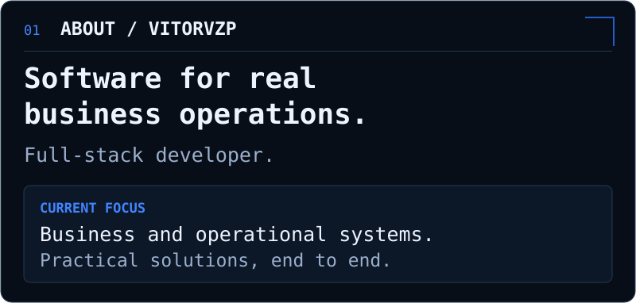
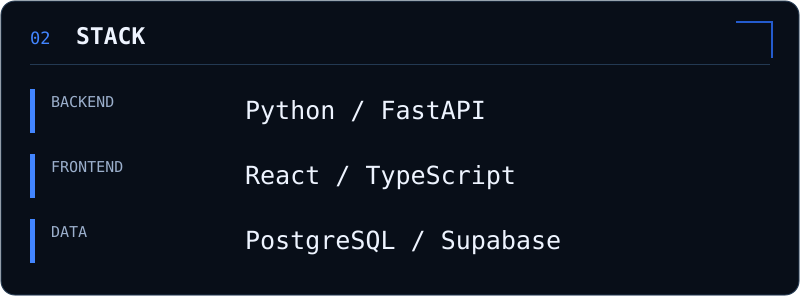
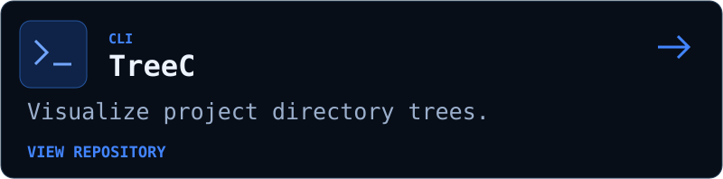
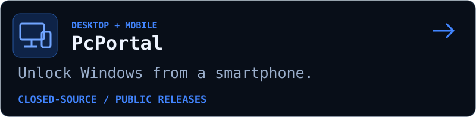
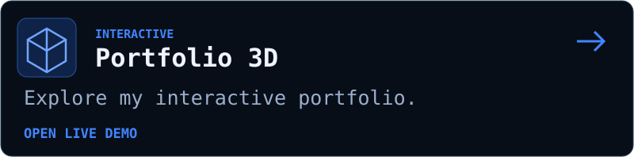

<!-- Image-based profile: all panels are editable, repository-local SVGs. -->

  

  

  

  

  

  

  

  

  

  

Text version

Vitor Emanuel (Vitorvzp) is a full-stack developer building software for business operations, focused on business and operational systems.

Stack: Python, FastAPI, React, TypeScript, PostgreSQL and Supabase.

- [TreeC](https://github.com/Vitorvzp/TreeC): CLI for visualizing project directory trees.
- [PcPortal](https://github.com/Vitorvzp/PcPortal): desktop and mobile project for unlocking Windows from a smartphone. Closed-source with public releases.
- [Portfolio 3D](https://byvitor.web.app/): interactive portfolio.
- [LinkedIn](https://www.linkedin.com/in/byvitor/).

