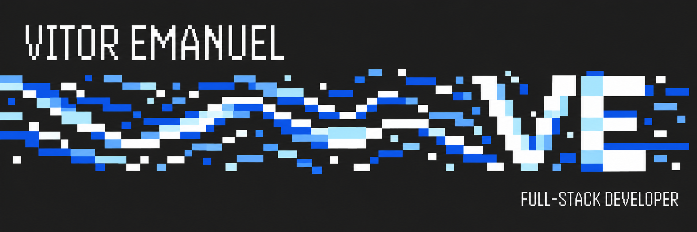
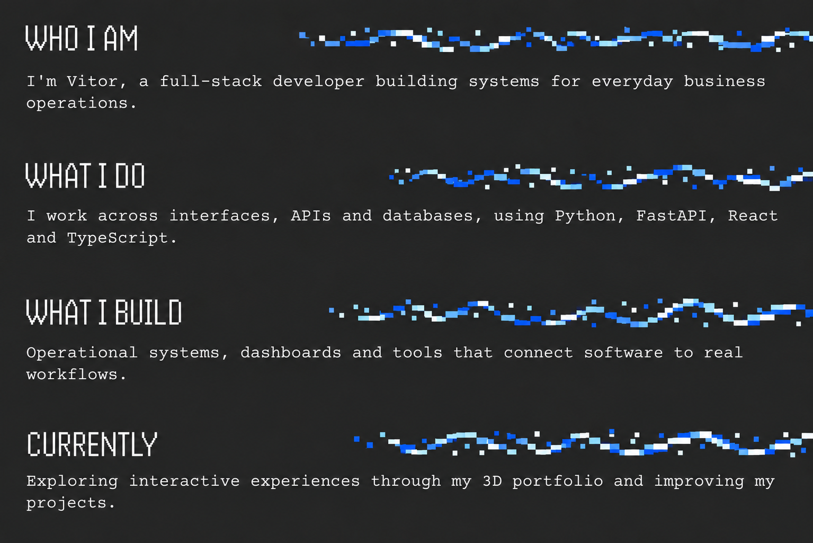
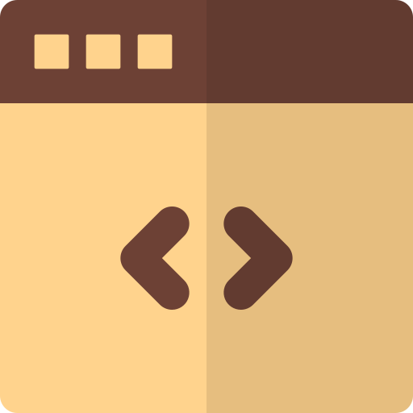
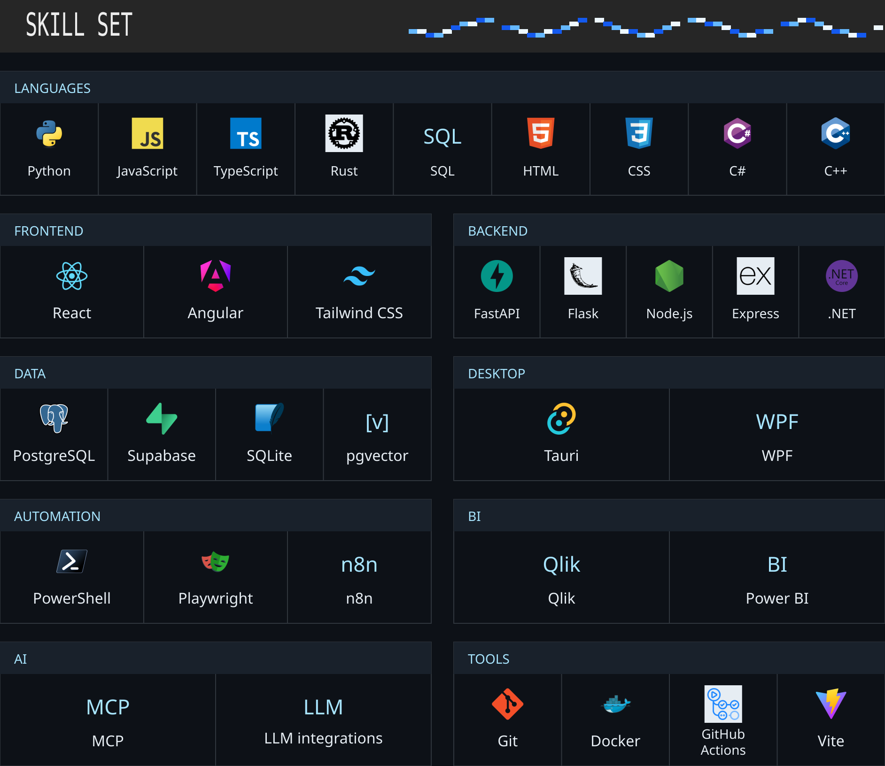

<!-- Approved blue VE identity: local artwork, editorial panels and clickable social icons. -->

  

  

<table width="100%">
  <tr>
    <th width="33%" align="center">Portfolio</th>
    <th width="34%" align="center">LinkedIn</th>
    <th width="33%" align="center">GitHub</th>
  </tr>
  <tr>
    <td align="center"></td>
    <td align="center"></td>
    <td align="center"></td>
  </tr>
</table>

  

Text version

### Who I am
I'm Vitor, a full-stack developer building systems for everyday business operations.

### What I do
I work across interfaces, APIs and databases, using Python, FastAPI, React and TypeScript.

### What I build
Operational systems, dashboards and tools that connect software to real workflows.

### Currently
Exploring interactive experiences through my [3D portfolio](https://byvitor.web.app/) and improving my projects.

### Skill set
- **Languages:** Python, JavaScript, TypeScript, Rust, SQL, HTML, CSS, C#, C++.
- **Frontend:** React, Angular, Tailwind CSS.
- **Backend:** FastAPI, Flask, Node.js, Express, .NET.
- **Data:** PostgreSQL, Supabase, SQLite, pgvector.
- **Desktop:** Tauri, WPF.
- **Automation:** PowerShell, Playwright, n8n.
- **BI:** Qlik, Power BI.
- **AI:** MCP, LLM integrations.
- **Tools:** Git, Docker, GitHub Actions, Vite.

[Portfolio](https://byvitor.web.app/) · [LinkedIn](https://www.linkedin.com/in/byvitor/) · [GitHub](https://github.com/Vitorvzp)

